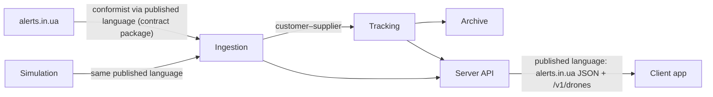
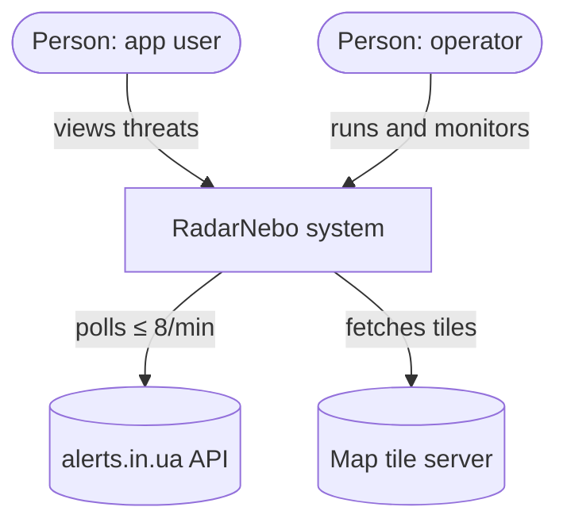
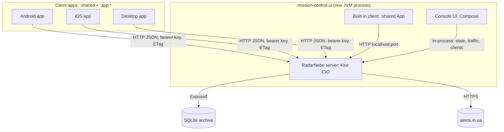
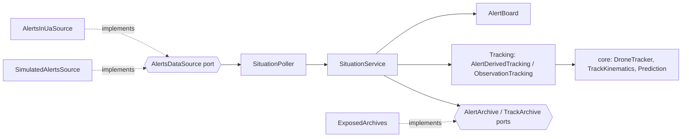
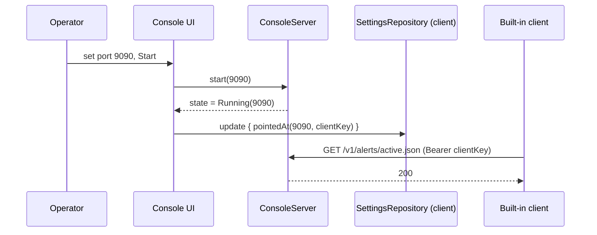

# RadarNebo — Architecture Design

## 1. Summary

- **What:** a drone- and missile-threat monitor for Ukraine. A Kotlin Multiplatform client (Android, iOS, desktop) reads
  only from its own server, which turns alerts.in.ua alerts (or a strike simulation) into tracked targets and an archive.
- **For whom:** people who want a map-first picture of threats near places they care about, and the developer running
  the server (mission control).
- **Chosen direction:** keep the existing shape: one server in front of alerts.in.ua, thin multiplatform clients.
- **Architecture style:** modular monolith server (Ktor, layered by DDD) plus a shared Compose client; no new
  containers.
- **Top 3 risks:** (1) users treat inferred tracks and predictions as authoritative warnings; (2) alerts.in.ua rate
  limits, terms or format change; (3) the 900-line UI files and untested `:shared` slow down change.
- **First next step:** merge the console→client wiring fix in this PR, then add a `:shared` test seam (milestone M1).

## 2. Calibration, facts, assumptions, open questions

**Class: S.** One developer, a hobby/demonstration project, no paying users, no SLA. It is safety-adjacent, so
section 11 keeps an explicit "not an official warning system" risk, but nothing here is a formal L-class design.

**Facts (from the repository):**

- Modules: `:core` (pure KMP logic), `:shared` (Compose UI, Koin), `:mission-control:server` (Ktor CIO, Exposed/SQLite),
  `:mission-control:ui` (desktop console that hosts the server and, since `b2e443c`, the client app), `:app:*` launchers.
- The server polls alerts.in.ua every 15 s, capped at `UPSTREAM_MAX_PER_MINUTE` (default 6, never above 8) by a
  sliding-window limiter, and backs off up to 10 min.
- The server's API re-publishes the alerts.in.ua format plus `/v1/drones/*` extensions. Optional bearer keys
  (`CLIENT_KEYS`).
- Archive: SQLite, partitioned by data source, pruned by `ARCHIVE_RETENTION_DAYS`.
- Tests: 28 test files in `:core`, server, console and desktop; none in `:shared`.
- At `b2e443c`, `main` did not compile: `TargetFilter` was referenced but never committed (the
  `.gitignore` rule `data/` matched the `data` source package), and `MacTrackpad.java`
  imported macOS-only classes, so `:app:desktop` failed on Linux/Windows JDKs. Fixed in this PR.

**Assumptions:**

- A1. Usage stays small: one server per operator, up to tens of clients.
- A2. alerts.in.ua remains the only real data source; it carries no positions, so tracks are always inferred.
- A3. The developer is fluent in Kotlin/Compose/Ktor; no other stack is wanted.

**Open questions:**

| # | Question | Decision it affects |
|---|---|---|
| Q1 | Will the server ever be public on the internet, or only on a LAN? | Auth (ADR-4), TLS, rate limits |
| Q2 | Should clients get push (WebSocket/SSE) instead of 30 s polling? | API style (ADR-3) |
| Q3 | Is an app-store release planned? | Disclaimer wording, privacy policy, iOS packaging |

## 3. Problem framing

Input type: **existing-system review** plus defects found in the latest commit.

**Job to be done:** "When an alert sounds, help me understand what is flying, where it is heading and whether it is
near my places, so I can decide to take cover."

**Today:** official alert apps say *that* an oblast or hromada is under alert, not *what* is coming or from where.
Telegram channels give text reports that are fast but unstructured. alerts.in.ua gives structured alerts but no
positions and strict rate limits (8–10 req/min soft per IP).

**5 whys (condensed):** clients can't call alerts.in.ua directly at scale → rate limits are per IP and small → a
server must fan out one upstream poll to many clients → and it must reconstruct tracks, because alerts carry no
coordinates. The underlying need is a single, rate-safe, track-aware source.

**Success metrics:**

- Primary: time from an upstream alert change to the client showing it, p95 ≤ 45 s (15 s poll + 30 s client poll).
- Guardrails: upstream requests never exceed 8/min; zero 401s from the console's own client; client crash-free
  sessions ≥ 99 %.

**Riskiest assumptions:**

| Assumption | Type | Impact × uncertainty |
|---|---|---|
| Inferred tracks are close enough to reality to be useful | Desirability/feasibility | High × high |
| alerts.in.ua stays available and tolerant of the polling pattern | Viability | High × medium |
| One developer can keep three platforms working | Feasibility | Medium × medium |

## 4. Ideas & evaluation

Directions generated before evaluation:

1. **Status quo+**: own server in front of alerts.in.ua, multiplatform clients (current).
2. **Client-only**: each app calls alerts.in.ua directly with the user's token.
3. **Telegram bot**: server pushes proximity warnings to a bot; no app.
4. **Buy/integrate**: contribute track display to an existing alert app instead of building one.
5. **Don't build software**: curate a list of reliable Telegram channels and official apps.
6. **Push platform**: server-sent events/WebSocket plus mobile push notifications.

| Direction | Value | Feasibility | Effort (5 = low) | Risk (5 = low) | Differentiation | Fit | Total |
|---|---|---|---|---|---|---|---|
| 1 Status quo+ | 4: map, tracks, favorites | 5: already built | 5: incremental | 4: upstream dependency | 4: tracks + prediction | 5 | **27** |
| 2 Client-only | 3: same UI, no tracks | 4 | 4 | 2: per-IP limits break | 2 | 2: loses archive | 17 |
| 3 Telegram bot | 3: fast, no map | 4 | 4 | 3 | 2 | 3 | 19 |
| 4 Integrate | 4 | 2: depends on third party | 3 | 2 | 1 | 2 | 14 |
| 5 No software | 2 | 5 | 5 | 4 | 1 | 1: not the goal | 18 |
| 6 Push platform | 5: lower latency | 3: FCM/APNs setup | 2 | 3 | 4 | 4 | 21 |

**Chosen:** 1. **Runner-up:** 6. It loses because polling already meets the 45 s target at A1's scale; it wins if
Q2 becomes "yes" or the client count grows past what 30 s polling serves cheaply.

## 5. MVP scope & validation experiment

The MVP exists. Kano and MoSCoW for the next increment:

| Feature | Kano | MoSCoW |
|---|---|---|
| Console's built-in client always points at the running server | Basic | Must (this PR) |
| Clear "not an official warning" disclaimer | Basic | Must |
| Favorites proximity alerts while app is in background | Performance | Should |
| Push notifications | Delighter | Could |
| Track accuracy score vs. later reports | Delighter | Could |
| Accounts, sync between devices | — | Won't (now) |

**Validation experiment (riskiest assumption: track usefulness):** record one week of real alerts.in.ua data from the
archive, replay it through `AlertDerivedTracking`, and compare predicted next settlements with the alerts that
actually followed. Exit criterion: next-settlement hit rate reported per threat kind; below 50 % means predictions
are hidden by default.

## 6. Domain model

**Event storming (lite), in time order:**

1. `UpstreamPolled` (policy: every 15 s, if the limiter allows) →
2. `AlertOpened` / `AlertChanged` / `AlertFinished` on `AlertBoard` →
3. policy "whenever an alert carries a drone or cruise-missile threat, then continue a nearby track of the same kind
   or open one" → `TargetObserved` → `TrackContinued` / `TrackStarted` →
4. `TrackEnded` (outcome `Intercepted` / `Impact` / `Lost`) → archived.
5. Client: `SituationRefreshed` → read model `ThreatPicture` → policy "whenever a threat is within the radius of a
   favorite, then flag the favorite".

**Aggregates:** `AlertBoard` (versioned active alerts), track (`ObservationTracking`), `Favorite`, `AppSettings`.
**Read models:** `/v1/alerts/active.json`, IoT status strings, `/v1/drones/tracks.json`, client `ThreatPicture`.

**Subdomains:**

| Subdomain | Type | Treatment |
|---|---|---|
| Tracking and prediction | Core | Build and invest (`core/tracking`, server `domain.tracking`) |
| Alert ingestion and fan-out | Supporting | Build simply (`application`, `infrastructure.upstream`) |
| Strike simulation | Supporting | Build simply; exists for demos and offline development |
| Map rendering, geography | Supporting | Build; data from OpenStreetMap |
| Auth, persistence, HTTP | Generic | Ktor auth, Exposed, SQLite |

**Context map:**



The `contract` package is the anti-corruption layer and the published language at once: the same JSON shape goes in
from upstream and out to clients, so any alerts.in.ua client also works against RadarNebo.

## 7. Architecture drivers

**Key use cases:** UC1 see active threats on a map; UC2 select a target and see track, type and predicted route;
UC3 get flagged when a threat nears a favorite; UC4 operator runs the server and watches traffic and clients;
UC5 operator demos the system offline (simulation); UC6 query history.

**Quality attributes (ranked):**

| # | Attribute | Scenario |
|---|---|---|
| 1 | Upstream safety (interoperability) | Source: 50 clients polling. Stimulus: each polls every 30 s. Response: upstream sees ≤ 8 req/min. Measure: limiter never exceeds `effectivePerMinute`. |
| 2 | Freshness | Source: upstream alert change. Environment: normal operation. Response: visible on client. Measure: p95 ≤ 45 s. |
| 3 | Modifiability | Source: developer. Stimulus: change the UI or a tracking rule. Response: change confined to one module, tests catch regressions. Measure: one module touched, CI green. |
| 4 | Operability | Source: operator. Stimulus: changes port or data source in the console. Response: server and built-in client follow. Measure: zero manual reconfiguration. |

Freshness and upstream safety conflict: faster polling breaks the rate limit. Resolved in favor of upstream safety
(rank 1); freshness is met through `If-Modified-Since` and ETags rather than more requests.

**Constraints:** Kotlin everywhere; Compose Multiplatform; single developer; zero budget; alerts.in.ua limits.

**Capacity (one line):** 50 clients × 2 req/min = 100 req/min ≈ 1.7 req/s, mostly 304s; upstream fixed at ≤ 6 req/min;
archive ≈ 2,000 alert records/day × 1 KB ≈ 2 MB/day ≈ 60 MB/month at 30-day retention. One JVM and SQLite suffice.

## 8. Options & trade-offs

| Option | Upstream safety | Freshness | Modifiability | Operability | Ops complexity | Team fit |
|---|---|---|---|---|---|---|
| **A. Modular monolith server + polling clients (current)** | High: one poller | Meets 45 s | Good with module rules | High: one process, console | Lowest | High |
| B. Monolith + SSE/WebSocket push | High | Better (≈ 15 s) | Same | Medium: connection state | Medium | High |
| C. Split ingestion and API services + queue | High | Same as A | Worse: two deployables | Low | High | Low for one developer |

**Selected: A.** Every driver is met without new containers. **Sensitivity points:** Q2 = push needed → B; clients
in the thousands, or a public deployment with separate scaling needs → revisit C (unlikely at A1).

## 9. Architecture

### C4 Level 1 — System context



### C4 Level 2 — Containers



The server also runs headless (`:mission-control:server:run`); the console is an optional host.

### C4 Level 3 — Core context (tracking)



### Key flows

**Console starts and its built-in client follows (this PR):**



**Upstream failure path:**

```mermaid
sequenceDiagram
  participant P as SituationPoller
  participant L as UpstreamRateLimiter
  participant U as alerts.in.ua
  participant Cl as Client
  P->>L: acquire
  L-->>P: ok
  P->>U: GET active.json (If-Modified-Since)
  U-->>P: 429 Retry-After: 60
  P->>P: back off (exponential, ≤ 10 min)
  Cl->>P: GET /v1/alerts/active.json
  P-->>Cl: last known alerts (304 or 200); /health shows lastError
```

### Data

| Context | Data | Store | Consistency | Retention |
|---|---|---|---|---|
| Server: alerts | `AirAlert` lifecycle records | SQLite (Exposed), partitioned by source | Strong within the single process | `ARCHIVE_RETENTION_DAYS` |
| Server: tracks | Finished tracks with samples | SQLite | Strong, written on track end | Same |
| Client | Settings, favorites | SharedPreferences / NSUserDefaults / properties file | Local only | Until user deletes |

Clients are eventually consistent with the server (poll interval). Schema evolution: Exposed `SchemaUtils` on start;
move to versioned migrations when the first column is renamed or dropped (deferred, see §10).

### Integration & APIs

- Sync HTTP everywhere; the only async boundary is the server's internal poller.
- Contract-first: the alerts.in.ua JSON is the contract; RadarNebo extensions live under `/v1/drones/*`.
- Idempotency: all client calls are GETs. Conditional requests (`ETag`, `If-Modified-Since`) keep polls cheap.
- Backpressure: upstream limiter; per-client limit on history (`HISTORY_REQUESTS_PER_MINUTE`).
- Versioning: path prefix (`/v1`, `/v2`) as upstream does.

### Security & privacy

- Authentication: optional static bearer keys (`CLIENT_KEYS`). Authorization: all-or-nothing.
- Data classification: alerts are public; favorites are personal location data and never leave the device.
- Secrets: `ALERTS_API_TOKEN` and `CLIENT_KEYS` from the environment or the git-ignored `.env`.

| Trust boundary | STRIDE concern | Mitigation |
|---|---|---|
| Client → server | Spoofing (no key), DoS | Bearer keys when exposed; per-IP rate limits, applied before the key check; gzip and 304s |
| Server → alerts.in.ua | Information disclosure (token in logs) | Token masked when `LOG_HTTP=true` |
| Server on LAN (`0.0.0.0`) | Tampering/eavesdropping over plain HTTP | Acceptable on a LAN; put a TLS reverse proxy in front before any public exposure (Q1). Behind it every client shares the proxy's IP, so the per-IP limits (120/min, history 2/min) become global: raise `CLIENT_REQUESTS_PER_MINUTE` / `HISTORY_REQUESTS_PER_MINUTE` or rate-limit at the proxy. Forwarded headers are deliberately not trusted. |
| Console's own client | Elevation via a stored key | Key copied from server config in memory, saved to the user's home only |

### Observability & reliability

- SLI: freshness, `now - dataConfirmedAt` from `/health` (the board routes send it as `X-Data-Age-Seconds`); SLO: data age ≤ 60 s for 99 % of minutes while upstream is healthy.
- Logs: logback, captured into the console's Logs tab. Traffic: `TrafficLog` (500 exchanges) in the console. There is no per-request access log: the full URI can carry `?token=`, and request traffic is already in `TrafficLog`; errors log the path only.
- Degradation: on upstream failure, serve last known state and expose the error in `/health`; clients show it.

### Deployment & operations

Single JVM: `./gradlew :mission-control:ui:run` (with console) or `:mission-control:server:run` (headless).
`SingleInstance` keeps one server per machine. Backup = copy the SQLite file. Rollback = previous Git tag. CI: n/a
today — the repository has no CI workflow; adding one is milestone M1.

### Technology stack

| Concern | Choice | Driver | Alternative |
|---|---|---|---|
| Server | Ktor CIO | A3, operability (in-process with console) | Spring Boot (heavier for one process) |
| Persistence | SQLite via Exposed | Capacity (≈ 60 MB), zero ops | PostgreSQL if Q1 → public multi-instance |
| Client UI | Compose Multiplatform | One codebase for 3 platforms | Native per platform |
| DI | Koin | Already used, simple KMP support | Manual wiring |

## 10. ADRs

**ADR-1: Own server in front of alerts.in.ua** — Accepted. *Context:* per-IP limits, no positions upstream.
*Decision:* clients talk only to the RadarNebo server. *Consequences:* + upstream safety, tracks, archive; − an extra
process to run. *Alternatives:* client-only (direction 2). *Door:* one-way (client API contract).

**ADR-2: Modular monolith server, DDD layers** — Accepted. *Context:* drivers 1–4, one developer. *Decision:* one
Ktor process; domain/application/infrastructure/api packages; ports for data sources and archives.
*Consequences:* + simple ops; − module rules are by convention only (see fitness functions). *Alternatives:* option C.
*Door:* two-way (packages can be extracted later).

**ADR-3: Polling with conditional requests, not push** — Accepted. *Context:* freshness target 45 s, A1 scale.
*Decision:* clients poll every 30 s (10–300 configurable) with ETags. *Consequences:* + stateless server; − up to 30 s
extra latency. *Revisit:* Q2 yes. *Door:* two-way.

**ADR-4: Optional static bearer keys** — Accepted. *Context:* LAN use, alerts.in.ua-compatible clients.
*Decision:* `CLIENT_KEYS` enables bearer auth, else the server is open. *Consequences:* + compatibility; − no
per-user identity or revocation beyond editing the list. *Revisit:* Q1 public. *Door:* two-way.

**ADR-5: Console drives its built-in client's endpoint** — Accepted (this PR). *Context:* driver 4; the client
captured `defaultPort` once at launch and kept any saved address; it had no key when `CLIENT_KEYS` was set.
*Decision:* whenever the server reaches `Running`, the console writes `http://localhost:<port>` and the first
configured client key into the client's settings (`AppSettings.pointedAt`). *Consequences:* + port changes and keys
just work; − manual edits to the built-in client's server address are overwritten on the next start (intended: that
client exists to show this server). *Alternatives:* a separate Koin binding read on every request (more code, no
gain). *Door:* two-way.

**Deferred decisions:**

| Decision | Trigger |
|---|---|
| Versioned DB migrations (e.g. Flyway) | First rename/drop of an archive column |
| Push (SSE/WebSocket, FCM/APNs) | Q2 yes, or background proximity alerts become a Must |
| TLS and per-client identities | Q1: server exposed beyond a LAN |
| PostgreSQL | More than one server instance |

## 11. Risks, pre-mortem, fitness functions

**Pre-mortem (failed after 12 months):** a user relied on a predicted route that was wrong; alerts.in.ua blocked the
server's IP or changed its format; the developer stopped because every UI change broke something on one platform;
the console's built-in client silently pointed at the wrong server and demos failed (fixed here).

| Risk | Likelihood | Impact | Mitigation | Owner | Early warning |
|---|---|---|---|---|---|
| Predictions read as official warnings | Medium | High | In-app disclaimer; "probable" labels already shown; validation experiment (§5) | Developer | User feedback quoting predictions |
| Upstream block or format change | Medium | High | Limiter, backoff, contract tests on the `contract` package | Developer | `/health` lastError, 401/403/429 counts |
| UI regressions on one platform | High | Medium | `PreviewsRenderTest`; add `:shared` tests; split large files | Developer | Bugs reported per platform |
| Single maintainer | High | Medium | README and this document; small modules | Developer | Commit gaps |

**Fitness functions:**

- Dependency rule: `:core` has no Compose or Ktor server dependency; server `domain` imports nothing from
  `infrastructure` or `api`. Check with a Konsist or ArchUnit test (verify current KMP support before choosing).
- Upstream budget: `UpstreamRateLimiter` test asserting ≤ `effectivePerMinute` over a simulated hour (exists in
  spirit in server tests; keep it).
- Contract: `AlertsInUaSourceTest` and `RadarApiTest` fixtures pin the published JSON.
- Previews: `PreviewsRenderTest` fails on any blank or throwing `@Preview`.
- Console wiring: `ClientPaneTest` pins `pointedAt` (this PR).

**Spikes, by risk reduction:** (1) prediction hit-rate replay (§5); (2) Konsist on KMP source sets; (3) SSE in Ktor
CIO with the Compose client, only if Q2 is yes.

## 12. Roadmap

Walking skeleton: done (server → API → client on three platforms, archive, console).

| Milestone | Scope | Exit criteria | Validates |
|---|---|---|---|
| M0 (this PR) | Restore the build (missing `TargetFilter`; `MacTrackpad` compiles off macOS); console→client wiring fix, ADR-5, this document | JVM tests green on Linux; built-in client works after a port change and with `CLIENT_KEYS` | Operability, modifiability |
| M1 | CI (GitHub Actions: JVM tests + previews); disclaimer in app | CI required on PRs | Modifiability |
| M2 | Split `MapScreen.kt`, `UkraineMap.kt`, `TargetsPanel.kt`; first `:shared` tests on `AppViewModel` | No file > 500 lines in `:shared/ui`; view-model tests exist | Modifiability |
| M3 | Prediction replay experiment and accuracy display | Hit rate per kind published; predictions gated by it | Riskiest assumption |
| M4 | Background proximity alerts (local notifications) | Works on Android and iOS with polling | UC3 |

**Not now:** accounts and sync, push infrastructure, microservices, PostgreSQL, public hosting.

## 13. Glossary

| Term | Meaning |
|---|---|
| Alert | An alerts.in.ua record: a location under a threat type, active or finished |
| Threat | The kind of danger in an alert (drones, missiles, KAB, aviation…) |
| Target | One tracked object or group, built from alerts or simulated sightings |
| Track | A target's ordered positions with kinematics and outcome |
| Favorite | A user's place, flagged when a threat is within the proximity radius |
| Prediction | Settlements ahead on a target's current heading, with arrival estimates |
| Console | `:mission-control:ui`, the desktop window that hosts the server |
| Built-in client | The shared app embedded in the console, shown by the Client toggle |
| Data source | Where the server gets alerts: alerts.in.ua or the simulation |
