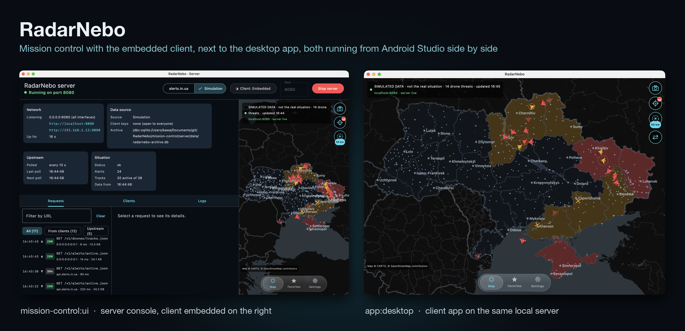

# RadarNebo



A Kotlin Multiplatform (Android + iOS, Compose Multiplatform) drone threat monitor for Ukraine. The app talks only to
the RadarNebo server (`:mission-control:server`). The server reads the [alerts.in.ua open API](https://devs.alerts.in.ua/), or simulates
combined drone and missile strikes when it has no token. It tracks targets, keeps the archive, and serves its own API
in the alerts.in.ua format.

## Screenshots

Rendered from the app's Compose previews (see [Previews](#previews)); the map and targets use hand-placed demo data.

| Map | Target selected | Cinematic mode | Targets |
|---|---|---|---|
|  |  |  |  |
| **Light theme** | **Threat card** | **Add a favorite (long-press)** | **Warning radius** |
|  |  |  |  |
| **Cities, zoomed out** | **City names, zoomed in** | **Every threat type** | **Target states** |
|  |  |  |  |
| **Favorites** | **Settings** | **Target types legend** | **Live demo (app)** |
|  |  |  |  |

**Tablet:** overview, a cruise missile's track and prediction, and cinematic mode.


**Target icons**, red and yellow alert levels:


## Features

- **Map of Ukraine**: drawn natively in Compose from simplified OpenStreetMap oblast boundaries. Oblasts are shaded by
  alert status (red: whole oblast, amber: partial). Drone threats are pulsing markers.
- **Simulated attacks** (server without `ALERTS_API_TOKEN`): `SimulatedAlertsSource` runs a combined-strike
  simulation instead of calling alerts.in.ua. Clients see the same API, and the app shows a *SIMULATED DATA* label from
  the `simulated` flag the server sends. See [Simulation](#simulation).
- **Drones only** (Settings): show only `drones` threats from `/v1/alerts/active.json`, or include missiles, KABs and
  aviation as well.
- **Favorite locations**: search a city, add by coordinates, or long-press anywhere on the map. A favorite is flagged
  when a threat is within the proximity radius, or when its oblast has a region-wide drone threat.
- **Two map modes**
  - *Static map*: a fixed overview of Ukraine. Pinch to zoom, double-tap to reset, tap a marker for details.
  - *Cinematic*: an automatic camera that flies between your points of interest that have nearby threats, using
    fly-to arcs, a slow push-in, letterboxing and a HUD. Toggle it with the camera button in the top-right corner. With nothing nearby, it patrols your favorites
    and the main hotspots.
- **Target types**: every threat is drawn with its own top-down icon (`ui/map/TargetGlyphs.kt`): attack, jet, decoy
  and reconnaissance drones, cruise, ballistic and aeroballistic (Kinzhal) missiles, guided bombs, tactical and
  strategic aviation, MiG-31K, air defense and unknown threats. Settings → Target types shows them all with their
  typical models and speeds (`tracking/TargetProfile.kt`).
- **Target tracking**: the Targets button (crosshair under the camera button) lists every tracked target: drone groups
  and, with "Drones only" off, cruise missiles. Each has its type's icon pointing along its heading, its model, latest
  location, time, speed and heading. Drone groups and cruise missiles are linked into tracks with their own speeds and
  hop distances (`TrackKinematics`); ballistic missiles, bombs and aviation only come as area alerts and stay markers.
  Selecting a target shows:
  - **Type**: class, model, maker, role and typical speed. alerts.in.ua doesn't identify models, so the model comes
    from the alert text when it names one (*reported*); otherwise it's inferred from the threat class and speed and
    marked *probable*.
  - **ID** (target and alert IDs), **speed**, **direction**, **distance flown** and **time tracked**.
  - **Predicted route**: the settlements ahead on the current heading (up to 150 km), each with minutes to arrival
    and clock time, drawn on the map as a dashed course with numbered stops.
  - **Timeline**: every reported position with its time, place, oblast and coordinates, plus the current estimate.

  Drones move continuously on the map: every frame their position is dead-reckoned from the last report (up to 30 min
  ahead), and when a new report corrects it the marker glides there instead of jumping.
- **Arrival prediction**: for each active target the app projects its current heading and speed to find the next
  settlement (or favorite) on its way within 50 km. It shows that place and an estimated arrival time in minutes on
  the map, in the target list and in the target details (`core/.../tracking/Prediction.kt`). The settlement list holds
  about 100 cities and towns. Predictions assume constant heading and speed, so they are rough indications only.
- **Light and dark themes**: Settings → Appearance offers System (the default, follows the OS), Light and Dark. The
  map, overlays and system bars all follow the chosen theme.
- **Floating liquid-glass navigation bar**: a pill-shaped bar that floats over the content. It shows a blurred,
  saturated and slightly magnified copy of whatever is behind it (`ui/LiquidGlass.kt`), and a glass lens slides
  between tabs.
- **Map max amount**: Settings → "Max drones shown on map" (5–300) caps how many markers are drawn. Proximity
  detection always uses every threat.

## Previews

Every screen and component has Compose `@Preview`s (78 in all), in `shared/src/commonMain`:

- `ui/preview/MapPreviews.kt`: the map screen (phone and tablet, light and dark, quiet, error), cities zoomed out and
  in, every target state on the map, every threat type, each card and control, and cinematic mode (threat near a
  favorite, patrol, overview).
- `ui/preview/TargetPreviews.kt`: the targets panel, with a detail view per target state (Shahed in flight with an
  arrival prediction, Gerbera decoy, jet Shahed, reconnaissance drone with a single report, cleared, cruise missile).
- `ui/preview/ScreenPreviews.kt`: the whole app (phone and tablet, with its own Koin container), favorites and settings.
- Next to their components: icons (`ui/map/TargetGlyphs.kt`), map buttons, glass bar, cards and panels.

Data comes from `ui/preview/PreviewData.kt`, hand-placed relative to the current time, so a preview always shows
what its name says. The app has no simulation of its own; that runs on the server.

Previews render on each platform's preview engine:

- **Android Studio** renders the Android target with Layoutlib, which can't blur a recorded graphics layer, so the
  liquid-glass bar falls back to a frosted tint there (`glassBackdropWorksInPreview`, an `expect`/`actual` per platform).
- **Desktop** (IntelliJ IDEA) renders with Skia like the app, real glass included.
- **iOS** has no Compose preview tooling; the previews still compile for it, as they live in `commonMain`.

IDE previews only render the first frames, so in inspection mode (`LocalInspectionMode`) anything that animates in
starts finished: city names show without fading in, the camera cuts to a selected target, and cinematic mode opens on
its first shot.

`PreviewsRenderTest` finds every `@Preview` from the sources (the annotation isn't visible to reflection), renders each
one headlessly at its declared size the way an IDE does, and fails on any that throws or draws a blank image
(`./gradlew :app:desktop:test`, PNGs in `app/desktop/build/snapshots/previews`). The screenshots above are regenerated with:

```
./gradlew :app:desktop:test --tests '*ReadmeScreenshotsTest*' -PupdateReadmeScreenshots
```

## Architecture

The shared app is wired with [Koin](https://insert-koin.io/) (`shared/.../di/AppModules.kt`):

| Layer | What | Scope |
|---|---|---|
| Platform | `KeyValueStorage`: SharedPreferences (`androidModule`), a properties file (`desktopModule`), NSUserDefaults (`iosModule`) | single |
| Platform | `ServerDefaults`: where the server is until the user sets one (`http://10.0.2.2:8080` on the Android emulator, `http://localhost:8080` elsewhere) | single |
| Data | `RadarNeboApi` (the server's client); `SettingsRepository` and `FavoritesRepository` (observable `StateFlow`s); `AlertsRepository` (alerts and tracks from the server) | single |
| Domain | `RefreshAlertsUseCase`, `BuildThreatPictureUseCase`, `UpdateSettingsUseCase`, `AddFavoriteUseCase`, `RemoveFavoriteUseCase` | factory |
| UI | `AppViewModel`, obtained with `koinViewModel()` in `App()` | viewModel |

Koin starts in `RadarNeboApplication` (Android), `main()` (desktop) and `MainViewController()` (iOS), each passing its
platform module to `initKoin`. Previews and tests use `isolatedKoin()` with in-memory storage inside
`KoinIsolatedContext`, so they never touch real settings or each other.

## Modules

| Module | What it is |
|---|---|
| `core` | Pure Kotlin (Android, iOS, JVM): the server's client, the alerts.in.ua JSON models, geography, threat mapping, tracking and interpolation |
| `shared` | Compose Multiplatform UI (Android, iOS, desktop JVM), repositories, use cases and Koin modules |
| `app/android` (`:app:android`), `app/desktop` (`:app:desktop`), `app/ios` (Xcode project) | Platform entry points |
| `mission-control/server` (`:mission-control:server`) | Ktor server: alerts.in.ua or the strike simulation, server-side tracking, SQLite archive, alerts.in.ua-compatible API |
| `mission-control/ui` (`:mission-control:ui`) | The Compose Desktop console that hosts the server |

## Desktop app

```
./gradlew :app:desktop:run                      # settings in ~/.radarnebo/settings.properties
./gradlew :app:desktop:packageDistributionForCurrentOS   # .dmg / .msi / .deb
```

Map controls on desktop:
- **Two-finger swipe** (trackpad) or **mouse wheel**: pan the map. Shift+wheel pans horizontally.
- **Pinch** (macOS trackpad): zoom around the cursor. Compose Desktop has no pinch support, so `MacTrackpad.java`
  hooks the JDK's native magnify gesture. Pinch needs `--add-exports java.desktop/com.apple.eawt.event=ALL-UNNAMED`,
  which the Gradle run and packaging config already pass.
- **Ctrl/⌘ + wheel**: zoom (mouse). **Drag**: pan. **Double-click**: reset. **Long-press**: add a favorite.

## Server (`:mission-control:server`)

The app's only data source. The server decides where the data comes from, tracks targets and archives everything;
apps only read. It is a Ktor (CIO) application in DDD layers, under `mission-control/server/src/main/kotlin/.../server/`:

| Layer | Package | What |
|---|---|---|
| Domain | `domain.alert`, `domain.tracking` | `AirAlert`, `AlertLocation`, `AlertBoard` (active alerts, versioned), `AirRaidStatusMap` (IoT status codes), `LocationDirectory`; `TargetObservation`, `ObservationTracking`; the `AlertArchive` and `TrackArchive` ports |
| Application | `application` | `AlertsDataSource` port, `SituationService` (state, archiving, queries), `SituationPoller` (polling, backoff, history replay, pruning) |
| Published language | `contract` | The alerts.in.ua JSON format and its mapping to the domain, used both upstream and for the server's own API |
| Infrastructure | `infrastructure.*` | `AlertsInUaSource` and `UpstreamRateLimiter`; `SimulatedAlertsSource` and the simulation; Exposed/SQLite and in-memory archives; `AlertDerivedTracking` |
| API | `api` | Routes, StatusPages errors, bearer auth, rate limits, gzip, CORS |

`ServerComponents` in `Main.kt` is the composition root.

### Data sources

- **alerts.in.ua** (`ALERTS_API_TOKEN` set): the only component that talks to alerts.in.ua, so the number of clients
  never affects the upstream rate. alerts.in.ua allows 8–10 requests/min per IP (soft) and 12 (hard). The server polls
  every 15 s; a sliding-window limiter caps it at `UPSTREAM_MAX_PER_MINUTE` (default 6, never above 8) and spaces
  requests evenly. It sends `If-Modified-Since`, honours `Retry-After` on 429 and backs off exponentially:
  up to 60 s on server or network errors, so the board recovers within a minute, and up to 10 min on 429/401/403.
  Alerts carry no positions, so tracks are reconstructed from them: a drone or cruise-missile threat appearing close
  to a recent track of the same kind continues it (`DroneTracker`, `TrackKinematics`).
- **Simulation** (no token, or `DATA_SOURCE=simulation`): see below. It reports what air surveillance would see, so
  tracks follow the real flight paths (`ObservationTracking`).

### Simulation

`SimulatedAlertsSource` runs `AirSituationSimulator`. It plans attacks, flies them, and at every tick reports what
Ukraine's warning system and air surveillance would: the alerts in force, in the alerts.in.ua shape, and a sighting
of every target in the air.

- **Combined strike**, every `SIM_STRIKE_PERIOD_MINUTES` (default 6 h), compressed from a real night
  (`CombinedStrikePlanner`):
  - **Drones:** 22–36 Shahed groups with Gerbera decoys, launched from Kursk, Oryol, Bryansk, Smolensk, Millerovo,
    Primorsko-Akhtarsk and occupied Crimea and Donetsk. They cross the border at real entry points and dogleg to
    3–5 objectives (energy, airfields, industry, Kyiv). Jet Shaheds join late.
  - **Kh-101:** 10–30 from Tu-95MS launch lines (Volgodonsk, the Caspian, Engels), under a nationwide
    strategic-aviation alert. They take winding routes through northern, eastern or south-eastern gates.
  - **Kalibr:** from the Black Sea, after a southern missile-carrier warning.
  - **Kinzhal:** a MiG-31K take-off raises a nationwide alert, usually followed by Kinzhals.
  - **Ballistic:** Iskander-M and KN-23 at the objectives within range, alerting the target and over-flown regions
    from launch.
- **Front line, all day** (`FrontlinePlanner`): KAB glide bombs from Su-34s on front-line and border towns, with
  tactical-aviation alerts in their oblasts; Orlan reconnaissance drones; small Shahed groups; the occasional
  Iskander. Luhansk oblast and Crimea are under a standing alert, as they really are.
- **Fate:** each flight's fate is decided at planning with realistic air-defence figures (about 80% of Shaheds and
  85% of cruise missiles intercepted, ballistic missiles far fewer). Interceptions raise *air defence* alerts nearby.
  Tracks end with `outcome` `Intercepted`, `Impact` or `Lost`.
- **Warning system** (`WarningSystem`, `AlertRegistry`): settlements near a target, or on its way within minutes, get
  red alerts. Settlements further along its way get yellow (preliminary) ones. Alerts keep their id while active, and
  threats open and clear within them. The all-clear lags the danger by a few minutes.
- **Determinism:** plans are seeded from `SIM_SEED` and the time slot, so restarts see the same attacks. The last
  `SIM_WARM_UP_MINUTES` (default 120) are replayed on start, so tracks have a history from the first request.

### API

Clients authenticate like alerts.in.ua (`Authorization: Bearer <key>` or `?token=<key>`) when `CLIENT_KEYS` is set.
A `?token=` that is not a valid bearer token is a 400. Rate limits apply before the key check, so requests with a wrong
key count too. Errors are `{"message": "..."}`. The active-alert and IoT status endpoints (`/v1/alerts/active.json`
and `/v{1,2}/iot/...`) support `ETag`/`If-None-Match` and `Last-Modified`/`If-Modified-Since` and report the data's age
in `X-Data-Age-Seconds`. ETags look like `"<boot id>-v<version>"` and change on every restart, so a copy from before a
restart never gets a 304. Responses over 1 KB are gzipped.

Limits are per client IP (`CLIENT_REQUESTS_PER_MINUTE`, 120/min; history `HISTORY_REQUESTS_PER_MINUTE`, 2/min; track
archive `ARCHIVE_REQUESTS_PER_MINUTE`, 10/min). With `TRUST_PROXY_HEADERS=true` the client IP is the last
`X-Forwarded-For` entry, the one the proxy added. That is safe only when the server port isn't published and every call
goes through the proxy, as in the compose deployment; anywhere else leave it `false`, or any client could pick its own IP.

**alerts.in.ua API** ([documentation](https://devs.alerts.in.ua/)): same paths and JSON, so any alerts.in.ua client works
against the server:

| Endpoint | Returns |
|---|---|
| `GET /v1/alerts/active.json` | `{"alerts": [...]}`, active alerts with their threats |
| `GET /v1/iot/active_air_raid_alerts_by_oblast.json` | `"ANPN…"`: 27 oblasts in the documented order, `A` whole / `P` partial / `N` none |
| `GET /v2/iot/active_air_raid_alerts_by_oblast.json` | The same with levels: `R` red, `Y` yellow, `P`, `N` |
| `GET /v{1,2}/iot/active_air_raid_alerts/{uid}.json` | One location's status, e.g. `"A"` |
| `GET /v{1,2}/iot/active_air_raid_alerts.json` | One character per location UID, a space for unassigned UIDs |
| `GET /v1/regions/{uid}/alerts/{period}.json` | History from the archive, finished alerts included. `period` is `month_ago` (also `week_ago`, `day_ago`). An oblast's history includes its raions, hromadas and cities. Limited to `HISTORY_REQUESTS_PER_MINUTE` (2, as upstream). |

**RadarNebo extensions:**

| Endpoint | Returns |
|---|---|
| `GET /v1/drones/tracks.json[?active=true]` | Every tracked target (drones, cruise and ballistic missiles, guided bombs) with its position history, plus `serverTime` and `simulated`. Long tracks are thinned so polls stay small. |
| `GET /v1/drones/positions.json?at=<ms or ISO-8601>` | Positions interpolated between samples, or dead-reckoned past the last one |
| `GET /v1/drones/archive.json?from=&to=&type=&limit=` | Finished and current tracks in a time window (default: the last day), newest first. The window is at most 7 days and `limit` at most 200 (the default); more is a 400. Limited to `ARCHIVE_REQUESTS_PER_MINUTE` (10). |
| `GET /health` | `status`, data source, freshness (`dataAgeSeconds`), upstream budget and outcome counts, last error (no key needed, but rate limited per IP like the other routes). Always 200; see below |

`/health` `status` is `warming_up` (no data yet), `ok`, `degraded` (the data source is failing and the server is backing
off; the last data is still served) or `stale` (the data is older than max(3 × poll interval, 60 s) while polls succeed,
or the poller is more than two poll intervals overdue). `upstreamRateLimitedTotal` (429), `upstreamRejectedTotal`
(401/403), `upstreamOtherFailuresTotal` and `upstreamLastSuccessAt` count alerts.in.ua outcomes since start, so a token
or IP drifting towards a block shows before it fails outright.

### Archive

Every alert is saved as it opens, changes and finishes, and every track as it ends, in SQLite via Exposed
(`ARCHIVE_JDBC_URL`, default `data/radarnebo-archive.db`; `memory` keeps it in memory). Records are partitioned by
data source, so simulated and real ids never mix. After a restart, alerts the archive still has open but that are gone
are finished. Records older than `ARCHIVE_RETENTION_DAYS` are pruned hourly while polls succeed.

### Running

```
./gradlew :mission-control:server:run                                   # simulation on :8080
ALERTS_API_TOKEN=... CLIENT_KEYS=key1,key2 ./gradlew :mission-control:server:run
./gradlew :mission-control:server:buildFatJar                           # build/libs/server-all.jar
```

For local runs, put the variables in `mission-control/server/.env` (git-ignored; start from `mission-control/server/.env.example`). `:mission-control:server:run`
loads it, and variables already set in the environment win.

### Deployment (Oracle Cloud)

`.github/workflows/ci.yml` runs the JVM tests on pushes to `main` and on every pull request. `.github/workflows/deploy.yml` runs on
pushes to `main` that touch the server, by hand from the Actions tab, or for a pull request labelled `deploy`
(redeployed on every push while the label stays). Pull requests and pushes deploy only when they change the server or
what it's built from: `core`, `mission-control/server`, `buildSrc`, `gradle`, the root build files or the workflow. It tests the server, builds the fat jar,
builds and pushes `<DOCKERHUB_USERNAME>/radarnebo-server:<commit sha>` for amd64 and arm64 from
`mission-control/server/Dockerfile`, scans both pushed architectures with Trivy (fails on fixable HIGH/CRITICAL), moves
`:latest` to that image (runs on `main` only, so pull request deploys never touch it), copies
`mission-control/server/docker-compose.yaml` to `~/docker-deployments/apps/radarnebo/radarnebo-server` on the VM over
SSH, writes the image and secrets to `.env` beside it, and runs `docker compose up -d --wait`, so a container that
doesn't turn healthy fails the deploy. It then removes this app's unused images (nothing else on the shared VM) and
fetches `https://<DOMAIN>/health` from the runner, so a broken proxy, certificate, DNS record or firewall fails it too.

Rollback: Actions → Deploy → Run workflow with `image_tag=<previous good commit sha>` (the full sha the image was
pushed under). It skips tests, build and scan and deploys that image. The VM keeps `.env` next to
`docker-compose.yaml` (mode 600), so `docker compose ps`, `logs` and `up -d` also work by hand there.

A pull request deploy stays live until the pull request loses the `deploy` label or is closed unmerged (main is then
redeployed), or until main deploys again.

Secrets it needs: `DOCKERHUB_USERNAME`, `DOCKERHUB_PASSWORD`, `SSH_HOST`, `SSH_USERNAME`, `SSH_KEY`, `SSH_PORT`,
`SSH_HOST_FINGERPRINT`, `ALERTS_IN_UA_API_KEY` (the server's `ALERTS_API_TOKEN`; empty runs the simulation) and
`CLIENT_KEYS`. `SSH_HOST_FINGERPRINT` is the `SHA256:...` value of the VM's ECDSA host key, from
`ssh-keyscan -t ecdsa -p <port> <host> | ssh-keygen -lf -`. It has to be the ECDSA key: the SSH actions' Go client
prefers ECDSA over RSA and ed25519 and can't be told otherwise, so an ed25519 fingerprint never matches. The SSH steps
refuse any other host key, so the deploy fails until it is set.

`.github/dependabot.yml` opens one weekly pull request per ecosystem: the workflow actions, the Gradle dependencies,
the server's base image (pinned by digest in the Dockerfile) and the compose file's images.

Caddy (`mission-control/server/Caddyfile`) runs as a second container in the same compose project, in front of the
server, and is the only thing with a published port (443). On first start it gets a Let's Encrypt certificate for `DOMAIN` (`radar-nebo.worxbend.com`; a repository variable `DOMAIN`
overrides it) and renews it on its own, proving the domain over port 443 (TLS-ALPN-01), so port 80 can stay with another service.
`DOMAIN`'s DNS A record must point at the VM. The server isn't published, so it trusts Caddy's `X-Forwarded-For`
(`TRUST_PROXY_HEADERS=true`) to rate-limit each client by its own IP. Apps use `https://<DOMAIN>` as the server URL.

The compose file requires `CLIENT_KEYS`: an empty or missing secret fails the deploy instead of serving an open
API (the server itself still runs open without keys, for local use, and logs a warning). Caddy adds HSTS,
`nosniff`, `Referrer-Policy`, a CSP and drops the `Server` header, and rejects request bodies over 1 KB. The server
container is limited to 512 MB (the JVM heap is 75% of that, and an `OutOfMemoryError` restarts it); raise
`mem_limit` in the compose file if `docker stats` shows pressure. Container logs rotate at 3 × 10 MB.

The VM needs Docker with Compose v2.17 or later, and port 443 (TCP, plus UDP for HTTP/3) open in the subnet's
security list and the host firewall. The archive and lock live in the `radarnebo-data` volume, the
certificates in `caddy-data`.

Backup and restore: the archive is derived history (up to 45 days of alerts and finished tracks), not live data, but
alerts.in.ua won't serve all of it again. SQLite runs in WAL mode, so a plain `cp` of the file while the server runs can
miss committed rows or copy a torn file; use SQLite's online backup instead. Compose prefixes the volume with the project
name (`docker volume ls | grep radarnebo-data`; normally `radarnebo-server_radarnebo-data`). A weekly snapshot that keeps
the last four, from the VM user's crontab (`crontab -e`; `%` must be escaped there):

```
0 3 * * 0 mkdir -p $HOME/backups && docker run --rm --user "$(id -u):$(id -g)" -v radarnebo-server_radarnebo-data:/data:ro -v $HOME/backups:/out keinos/sqlite3:3.53.4 sqlite3 /data/radarnebo-archive.db ".backup /out/archive-$(date +\%F).db" && ls -1t $HOME/backups/archive-*.db | tail -n +5 | xargs -r rm --
```

The server keeps running; the snapshot includes what is still in the WAL. Copies on the same VM don't survive losing
it, so copy them off now and then, or enable an OCI backup policy on the boot volume instead. To restore, in the
compose directory:

```
docker compose stop radarnebo-server
docker run --rm --user 10001:10001 -v radarnebo-server_radarnebo-data:/data -v $HOME/backups:/in:ro keinos/sqlite3:3.53.4 \
  sh -c 'rm -f /data/radarnebo-archive.db-wal /data/radarnebo-archive.db-shm && cp /in/archive-<date>.db /data/radarnebo-archive.db'
docker compose start radarnebo-server
```

Remove the `-wal` and `-shm` files, or SQLite would apply the old WAL to the restored file. `10001` is the server
image's user, so the restored file stays writable for it.

Monitoring: `/health` answers 200 in every state, so a status-code check can't see stale or failing data. In Uptime
Kuma, add an `HTTP(s) - Keyword` monitor on `https://<DOMAIN>/health` for the keyword `"status":"ok"`. Kuma runs on the
same VM, so it can't see the VM itself go down: add one more uptime check from another provider against the same URL.

To run the same image locally:

```
./gradlew :mission-control:server:buildFatJar
docker build -t radarnebo-server:local mission-control/server
# DOMAIN=localhost: Caddy uses its own local CA instead of Let's Encrypt (curl -k https://localhost/health).
# CLIENT_KEYS is required by the compose file; any dummy key works locally.
RADARNEBO_SERVER_IMAGE=radarnebo-server:local DOMAIN=localhost CLIENT_KEYS=local-key docker compose -f mission-control/server/docker-compose.yaml up
```

### Map background

The map can show a real map under the oblasts: a dark or light map that follows the theme, or satellite imagery
(Settings → Map). The dark and light maps are Carto's label-free basemaps, bundled with the app as resources
(`shared/src/commonMain/composeResources/files/map`) so they work offline; satellite imagery comes from Esri's public
tile service (no key needed). Tiles are cached in memory and drawn reprojected onto the app's map, so coastlines and
rivers line up with the oblast borders. The required credit is shown in the map's corner. Tests and previews draw
no tiles.

The bundled tiles cover everything the camera can show (zoom 3–9; closer views upscale zoom 9). To refresh them, or
after changing the map's bounds or zoom limits, put a Carto basemaps key in `local.properties` as `carto.apiKey=…`
(or `CARTO_API_KEY`) and run `python3 -I tools/download-map-tiles.py`; `--dry-run` prints the area and tile counts.

### Server console

`./gradlew :mission-control:ui:run` runs the server inside a desktop window instead of a terminal, configured the same way
(environment and `mission-control/server/.env`, same archive). The window has:
- **Start/Stop** buttons and the port, the addresses it listens on (localhost and LAN) and its uptime.
- The data source, the alerts.in.ua budget used, the last and next poll, and the situation it serves.
- **Requests**: every call from clients (↓) and to alerts.in.ua (↑), with headers and pretty-printed JSON. Keys and
  tokens are masked.
- **Clients**: who has called, how often, their last request and status.
- **Logs**: the server's log, filterable by level and text.
- **Client** (top bar): one button that cycles the client app, the same `App()` the desktop app shows, through
  *Hidden*, *Embedded* (a phone-wide pane on the right) and *Fullscreen* (everything below the top bar). It talks to this
  server, with its own settings in `~/.radarnebo/mission-control-client.properties`; hiding it stops its polling.

Restarting from the console keeps one alerts.in.ua rate limiter, so restarts can't exceed the budget. It can't run
alongside `:mission-control:server:run`: there is one server per machine, and starting either stops the other.

The apps have a request inspector too: the ⇄ button on the map, *Show requests* on the server card, or Settings →
Developer. On desktop it opens a separate window, on Android a separate screen.

To see the JSON going over the wire, set `LOG_HTTP=true`: the server logs its alerts.in.ua exchanges, and the desktop
app (`LOG_HTTP=true ./gradlew :app:desktop:run`) logs its requests to the server and the responses. Both print to the
console they run in; access keys and tokens are masked.

| Env var | Default | Meaning |
|---|---|---|
| `ALERTS_API_TOKEN` | – | alerts.in.ua token. If unset, the server runs the simulation and makes no upstream requests. |
| `DATA_SOURCE` | – | `simulation` or `alerts_in_ua`, to choose explicitly |
| `UPSTREAM_MAX_PER_MINUTE` | 6 | Upstream budget, clamped to 1–8 |
| `POLL_INTERVAL_SECONDS` | 15 | Never faster than the budget allows |
| `SIM_STRIKE_PERIOD_MINUTES` | 360 | Time between combined strikes (at least 180) |
| `SIM_TICK_SECONDS` | 10 | How often the simulation reports |
| `SIM_WARM_UP_MINUTES` | 120 | History replayed on start |
| `SIM_SEED` | 20220224 | Change it for different attacks |
| `ARCHIVE_JDBC_URL` | `jdbc:sqlite:data/radarnebo-archive.db` | `memory` for no persistence |
| `ARCHIVE_RETENTION_DAYS` | 45 | At least 1; 0 would prune the whole archive |
| `CLIENT_KEYS` | – | Comma-separated client keys (`PROXY_CLIENT_KEYS` still works) |
| `CLIENT_REQUESTS_PER_MINUTE` | 120 | Per-IP limit for clients, at least 1 |
| `HISTORY_REQUESTS_PER_MINUTE` | 2 | Per-IP limit for the history endpoint, at least 1 |
| `ARCHIVE_REQUESTS_PER_MINUTE` | 10 | Per-IP limit for `/v1/drones/archive.json`, at least 1 |
| `TRUST_PROXY_HEADERS` | false | Take the client IP from the proxy's `X-Forwarded-For` entry. Only behind a proxy that is the sole way in |
| `PORT` | 8080 | 0–65535; 0 picks a free port |
| `LOG_HTTP` | – | `true` logs each alerts.in.ua request and response with its JSON body (token masked) |

Unset or blank means the default. A malformed value (a number that doesn't parse, a boolean other than `true` or
`false`, an unknown `DATA_SOURCE`) or a number outside the range above stops the server at startup with a message
naming the variable (the console shows it in a dialog), since falling back would hide the mistake.

## Connecting the app

The app needs only the server's address (Settings → Server) and, if the server requires one, an access key. It never
sees an alerts.in.ua token: that lives on the server. Earlier versions kept the token on the device; it is removed on
the first settings save. By default the app looks for a server on the same machine (the Android emulator reaches it as
`10.0.2.2`; cleartext HTTP is allowed only to that and `localhost`). Polling defaults to 30 s. The server answers
unchanged data with a 304, and the app interpolates target positions every frame between polls.

The alerts.in.ua API gives no coordinates for raions or hromadas. Known cities are placed exactly, oblast-wide alerts
sit at the oblast centroid, and other locations get a stable pseudo-random spot inside their oblast.


* [/app/ios](./app/ios/iosApp) contains an iOS application. Even if you’re sharing your UI with Compose Multiplatform,
  you need this entry point for your iOS app. This is also where you should add SwiftUI code for your project.

* [/shared](./shared/src) is for code that will be shared across your Compose Multiplatform applications.
  It contains several subfolders:
  - [commonMain](./shared/src/commonMain/kotlin) is for code that’s common for all targets.
  - Other folders are for Kotlin code that will be compiled for only the platform indicated in the folder name.
    For example, if you want to use Apple’s CoreCrypto for the iOS part of your Kotlin app,
    the [iosMain](./shared/src/iosMain/kotlin) folder would be the right place for such calls.
    Similarly, if you want to edit the Desktop (JVM) specific part, the [jvmMain](./shared/src/jvmMain/kotlin)
    folder is the appropriate location.

### Running the apps

Android Studio picks up the shared run configurations in [`.run/`](./.run) and lists them in the toolbar's run widget:

| Configuration | Runs |
|---|---|
| `app:android` | The Android app on the selected device or emulator |
| `app:ios` | The iOS app on the selected simulator (needs the Kotlin Multiplatform plugin and Xcode) |
| `app:desktop` / `app:desktop [hot]` | `./gradlew :app:desktop:run` / `hotRun` (Compose Hot Reload) |
| `mission-control:ui` / `mission-control:ui [hot]` | `./gradlew :mission-control:ui:run` / `hotRun` |
| `mission-control:server` | `./gradlew :mission-control:server:run`, the server without a window |
| `mission-control:ui + app:desktop` | Both of the above at once |

The desktop and mission-control configurations run `./gradlew` as shell scripts, so each is a Gradle build of its own
and they run side by side, alongside the Android or iOS app. Android Studio's own Gradle runs would queue behind a
running app instead. Stop ends the build and the app. The one pair that doesn't run together is `mission-control:ui`
and `mission-control:server`: there is one server per machine, and the one started later takes over.

From a terminal:

- Android app: `./gradlew :app:android:assembleDebug`
- Desktop app: `./gradlew :app:desktop:run`
- iOS app: open the [/app/ios](./app/ios) directory in Xcode and run it from there.

---

Learn more about [Kotlin Multiplatform](https://www.jetbrains.com/help/kotlin-multiplatform-dev/get-started.html)…