# RadarNebo

A Kotlin Multiplatform (Android + iOS, Compose Multiplatform) drone threat monitor for Ukraine. The app talks only to
the RadarNebo server (`:server`). The server reads the [alerts.in.ua open API](https://devs.alerts.in.ua/), or simulates
combined drone and missile strikes when it has no token. It tracks targets, keeps the archive, and serves its own API
in the alerts.in.ua format.

## Screenshots

Rendered from the app's Compose previews (see [Previews](#previews)); the map and targets use hand-placed demo data.

| Map | Target selected | Cinematic mode | Targets |
|---|---|---|---|
| 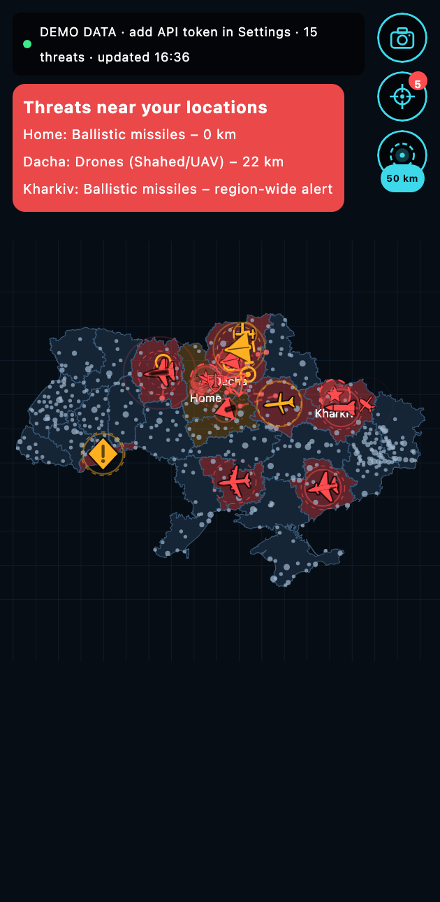 | 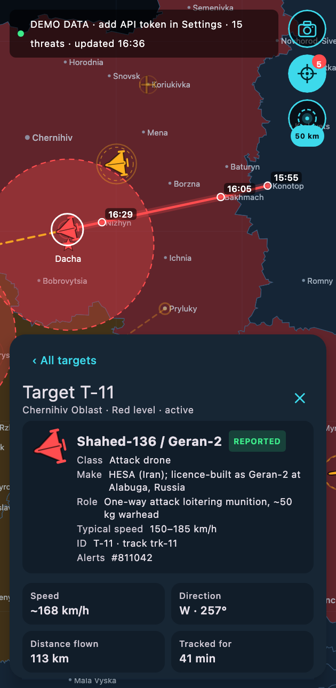 | 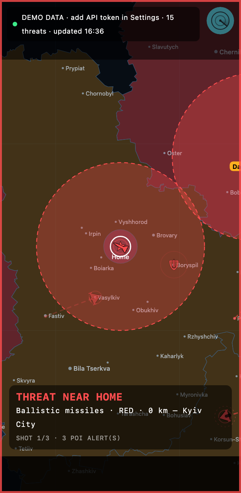 | 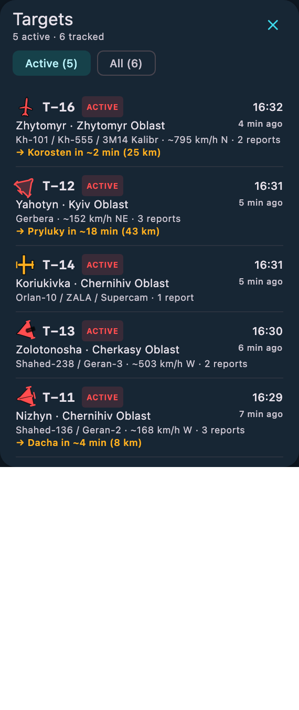 |
| **Light theme** | **Threat card** | **Add a favorite (long-press)** | **Warning radius** |
| 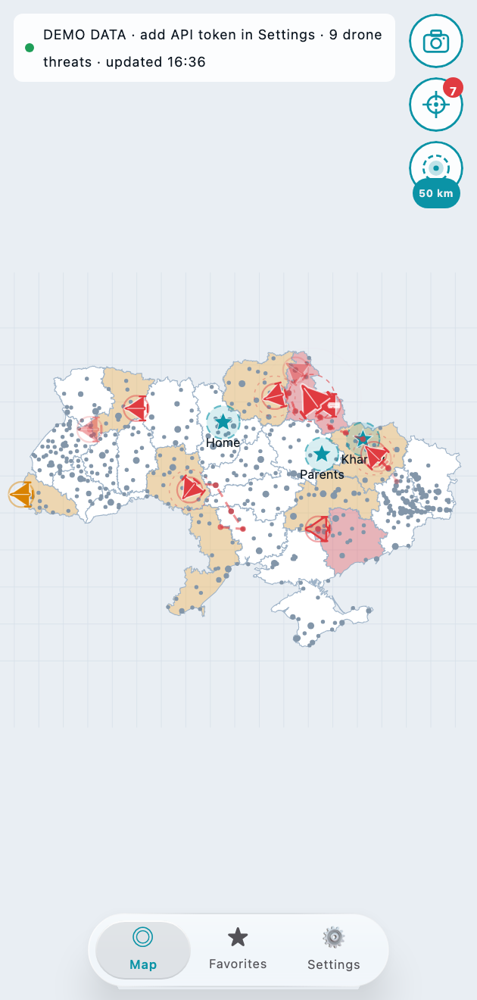 | 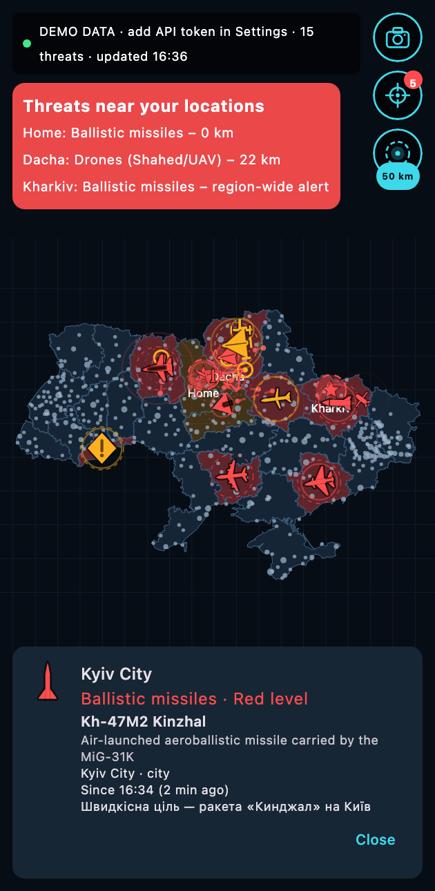 | 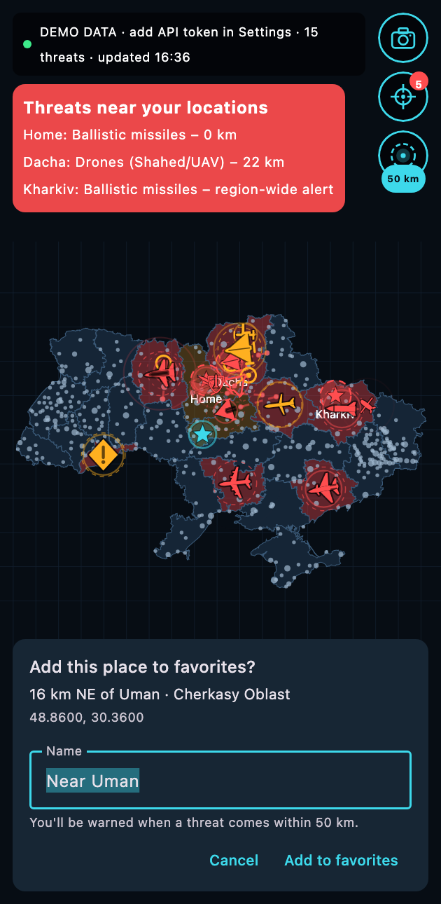 | 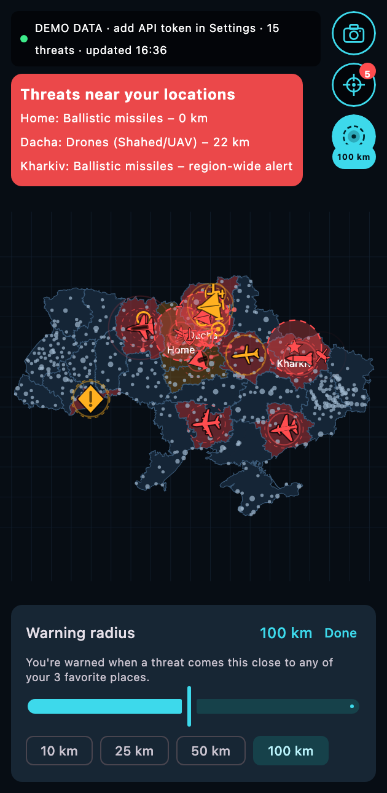 |
| **Cities, zoomed out** | **City names, zoomed in** | **Every threat type** | **Target states** |
| 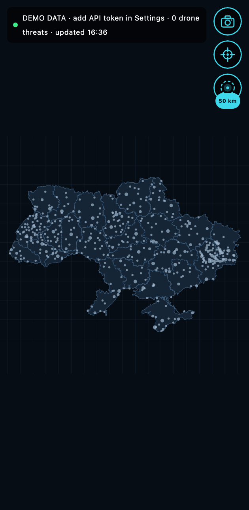 | 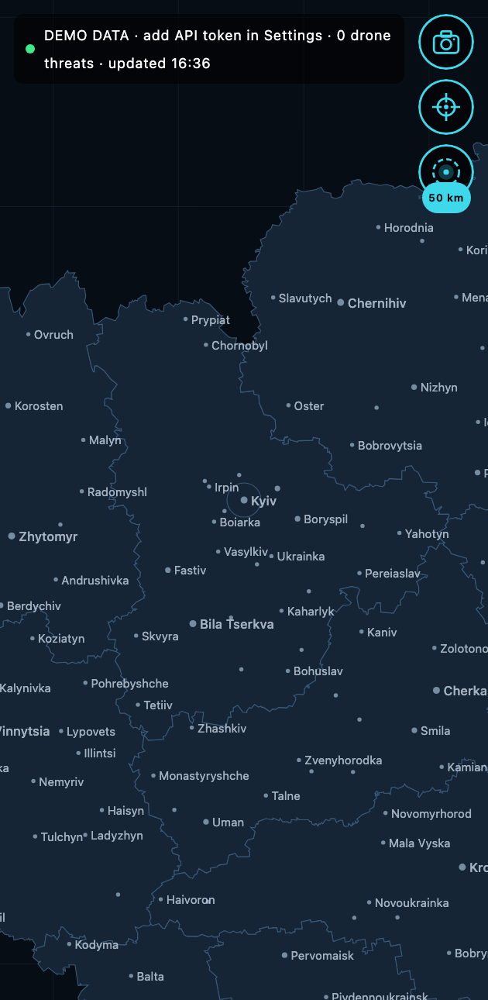 | 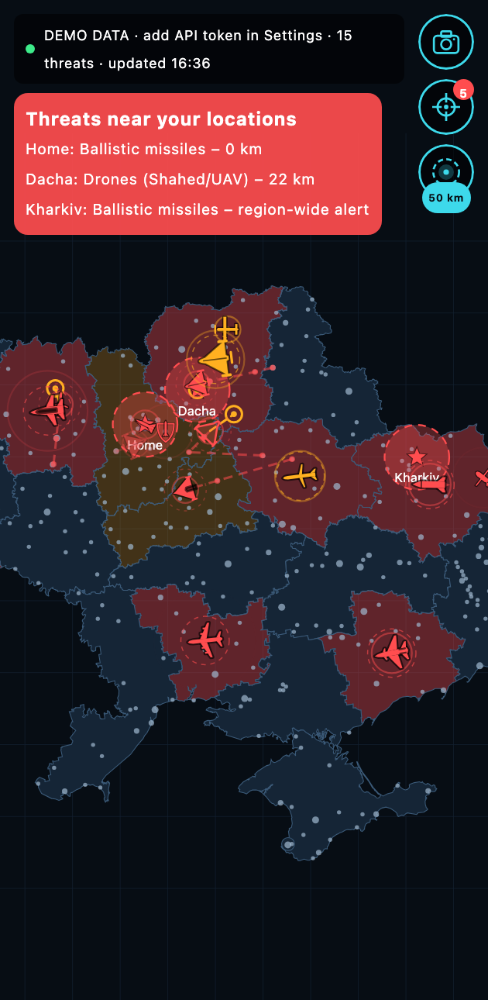 | 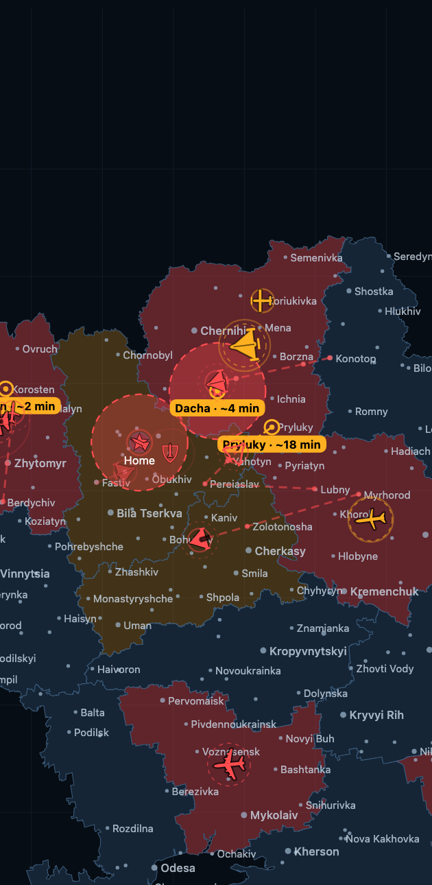 |
| **Favorites** | **Settings** | **Target types legend** | **Live demo (app)** |
| 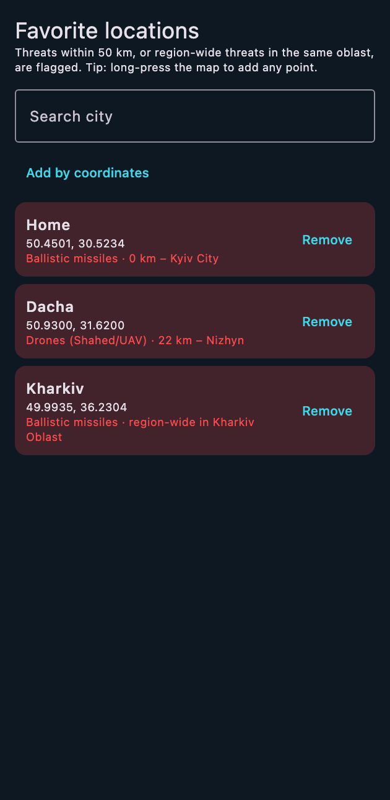 | 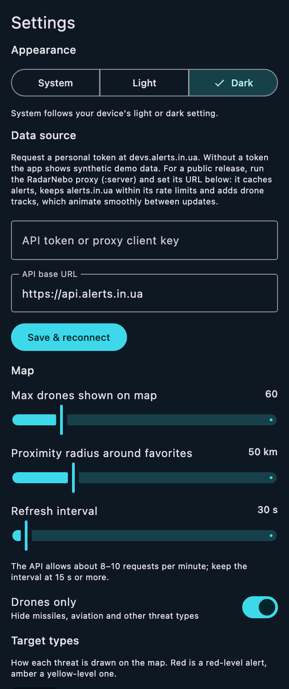 | 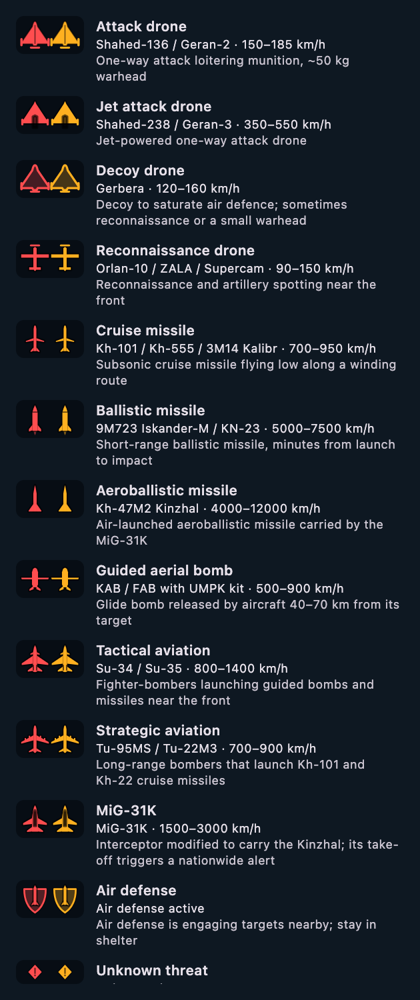 | 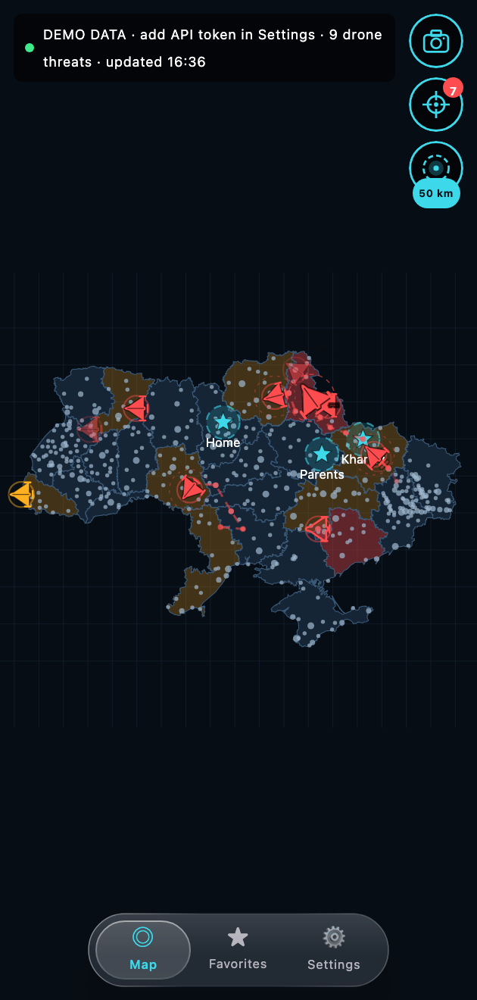 |

**Tablet:** overview, a cruise missile's track and prediction, and cinematic mode.

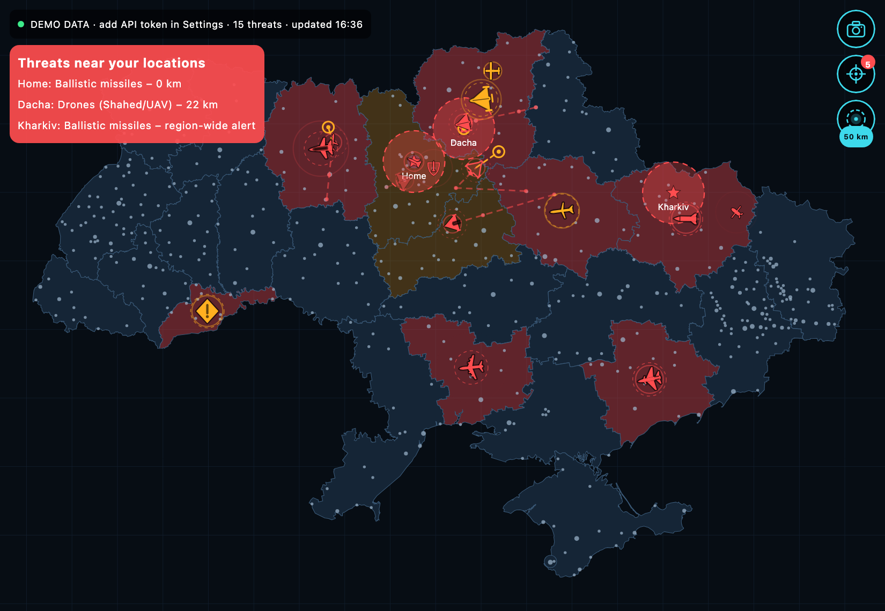
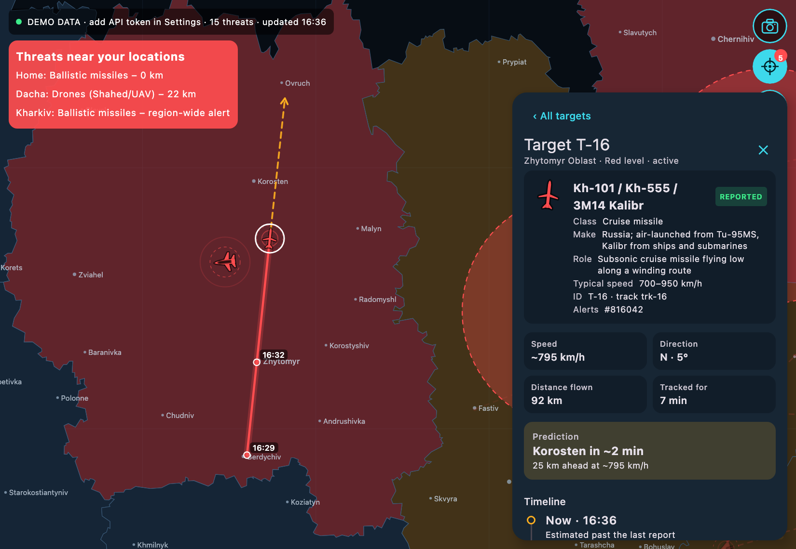
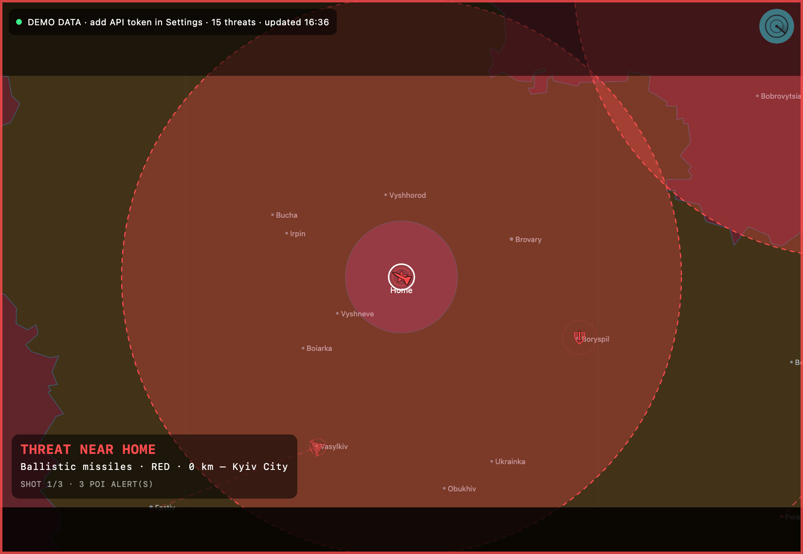

**Target icons**, red and yellow alert levels:

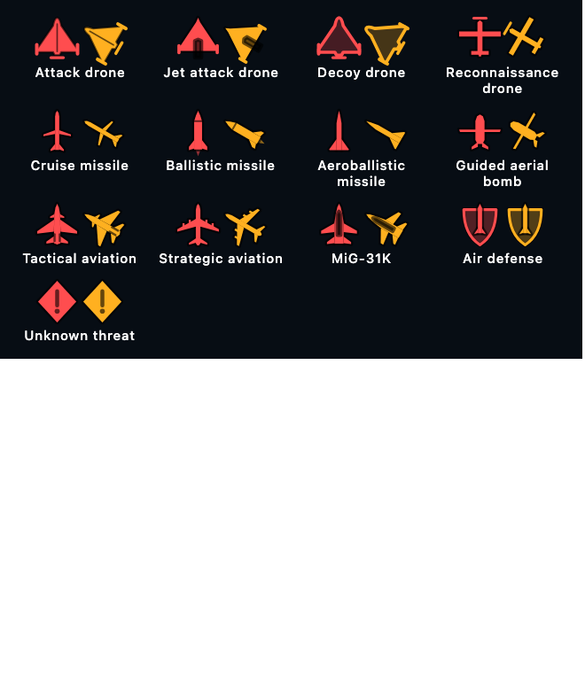

## Features

- **Map of Ukraine**: drawn natively in Compose from simplified OpenStreetMap oblast boundaries. Oblasts are shaded by
  alert status (red: whole oblast, amber: partial). Drone threats are pulsing markers.
- **Simulated attacks** (server without `ALERTS_API_TOKEN`): `SimulatedAlertsSource` runs a combined-strike
  simulation instead of calling alerts.in.ua. Clients see the same API, and the app shows a *SIMULATED DATA* label from
  the `simulated` flag the server sends. See [Simulation](#simulation).
- **Drones only** (Settings): show only `drones` threats from `/v1/alerts/active.json`, or include missiles, KABs and
  aviation as well.
- **Favorite locations**: search a city, add by coordinates, or long-press anywhere on the map. A favorite is flagged
  when a threat is within the proximity radius, or when its oblast has a region-wide drone threat.
- **Two map modes**
  - *Static map*: a fixed overview of Ukraine. Pinch to zoom, double-tap to reset, tap a marker for details.
  - *Cinematic*: an automatic camera that flies between your points of interest that have nearby threats, using
    fly-to arcs, a slow push-in, letterboxing and a HUD. Toggle it with the camera button in the top-right corner. With nothing nearby, it patrols your favorites
    and the main hotspots.
- **Target types**: every threat is drawn with its own top-down icon (`ui/map/TargetGlyphs.kt`): attack, jet, decoy
  and reconnaissance drones, cruise, ballistic and aeroballistic (Kinzhal) missiles, guided bombs, tactical and
  strategic aviation, MiG-31K, air defense and unknown threats. Settings → Target types shows them all with their
  typical models and speeds (`tracking/TargetProfile.kt`).
- **Target tracking**: the Targets button (crosshair under the camera button) lists every tracked target: drone groups
  and, with "Drones only" off, cruise missiles. Each has its type's icon pointing along its heading, its model, latest
  location, time, speed and heading. Drone groups and cruise missiles are linked into tracks with their own speeds and
  hop distances (`TrackKinematics`); ballistic missiles, bombs and aviation only come as area alerts and stay markers.
  Selecting a target shows:
  - **Type**: class, model, maker, role and typical speed. alerts.in.ua doesn't identify models, so the model comes
    from the alert text when it names one (*reported*); otherwise it's inferred from the threat class and speed and
    marked *probable*.
  - **ID** (target and alert IDs), **speed**, **direction**, **distance flown** and **time tracked**.
  - **Predicted route**: the settlements ahead on the current heading (up to 150 km), each with minutes to arrival
    and clock time, drawn on the map as a dashed course with numbered stops.
  - **Timeline**: every reported position with its time, place, oblast and coordinates, plus the current estimate.

  Drones move continuously on the map: every frame their position is dead-reckoned from the last report (up to 30 min
  ahead), and when a new report corrects it the marker glides there instead of jumping.
- **Arrival prediction**: for each active target the app projects its current heading and speed to find the next
  settlement (or favorite) on its way within 50 km. It shows that place and an estimated arrival time in minutes on
  the map, in the target list and in the target details (`core/.../tracking/Prediction.kt`). The settlement list holds
  about 100 cities and towns. Predictions assume constant heading and speed, so they are rough indications only.
- **Light and dark themes**: Settings → Appearance offers System (the default, follows the OS), Light and Dark. The
  map, overlays and system bars all follow the chosen theme.
- **Floating liquid-glass navigation bar**: a pill-shaped bar that floats over the content. It shows a blurred,
  saturated and slightly magnified copy of whatever is behind it (`ui/LiquidGlass.kt`), and a glass lens slides
  between tabs.
- **Map max amount**: Settings → "Max drones shown on map" (5–300) caps how many markers are drawn. Proximity
  detection always uses every threat.

## Previews

Every screen and component has Compose `@Preview`s (78 in all), in `shared/src/commonMain`:

- `ui/preview/MapPreviews.kt`: the map screen (phone and tablet, light and dark, quiet, error), cities zoomed out and
  in, every target state on the map, every threat type, each card and control, and cinematic mode (threat near a
  favorite, patrol, overview).
- `ui/preview/TargetPreviews.kt`: the targets panel, with a detail view per target state (Shahed in flight with an
  arrival prediction, Gerbera decoy, jet Shahed, reconnaissance drone with a single report, cleared, cruise missile).
- `ui/preview/ScreenPreviews.kt`: the whole app (phone and tablet, with its own Koin container), favorites and settings.
- Next to their components: icons (`ui/map/TargetGlyphs.kt`), map buttons, glass bar, cards and panels.

Data comes from `ui/preview/PreviewData.kt`, hand-placed relative to the current time, so a preview always shows
what its name says. The app has no simulation of its own; that runs on the server.

Previews render on each platform's preview engine:

- **Android Studio** renders the Android target with Layoutlib, which can't blur a recorded graphics layer, so the
  liquid-glass bar falls back to a frosted tint there (`glassBackdropWorksInPreview`, an `expect`/`actual` per platform).
- **Desktop** (IntelliJ IDEA) renders with Skia like the app, real glass included.
- **iOS** has no Compose preview tooling; the previews still compile for it, as they live in `commonMain`.

IDE previews only render the first frames, so in inspection mode (`LocalInspectionMode`) anything that animates in
starts finished: city names show without fading in, the camera cuts to a selected target, and cinematic mode opens on
its first shot.

`PreviewsRenderTest` finds every `@Preview` from the sources (the annotation isn't visible to reflection), renders each
one headlessly at its declared size the way an IDE does, and fails on any that throws or draws a blank image
(`./gradlew :app:desktop:test`, PNGs in `app/desktop/build/snapshots/previews`). The screenshots above are regenerated with:

```
./gradlew :app:desktop:test --tests '*ReadmeScreenshotsTest*' -PupdateReadmeScreenshots
```

## Architecture

The shared app is wired with [Koin](https://insert-koin.io/) (`shared/.../di/AppModules.kt`):

| Layer | What | Scope |
|---|---|---|
| Platform | `KeyValueStorage`: SharedPreferences (`androidModule`), a properties file (`desktopModule`), NSUserDefaults (`iosModule`) | single |
| Platform | `ServerDefaults`: where the server is until the user sets one (`http://10.0.2.2:8080` on the Android emulator, `http://localhost:8080` elsewhere) | single |
| Data | `RadarNeboApi` (the server's client); `SettingsRepository` and `FavoritesRepository` (observable `StateFlow`s); `AlertsRepository` (alerts and tracks from the server) | single |
| Domain | `RefreshAlertsUseCase`, `BuildThreatPictureUseCase`, `UpdateSettingsUseCase`, `AddFavoriteUseCase`, `RemoveFavoriteUseCase` | factory |
| UI | `AppViewModel`, obtained with `koinViewModel()` in `App()` | viewModel |

Koin starts in `RadarNeboApplication` (Android), `main()` (desktop) and `MainViewController()` (iOS), each passing its
platform module to `initKoin`. Previews and tests use `isolatedKoin()` with in-memory storage inside
`KoinIsolatedContext`, so they never touch real settings or each other.

## Modules

| Module | What it is |
|---|---|
| `core` | Pure Kotlin (Android, iOS, JVM): the server's client, the alerts.in.ua JSON models, geography, threat mapping, tracking and interpolation |
| `shared` | Compose Multiplatform UI (Android, iOS, desktop JVM), repositories, use cases and Koin modules |
| `app/android` (`:app:android`), `app/desktop` (`:app:desktop`), `app/ios` (Xcode project) | Platform entry points |
| `server` | Ktor server: alerts.in.ua or the strike simulation, server-side tracking, SQLite archive, alerts.in.ua-compatible API |

## Desktop app

```
./gradlew :app:desktop:run                      # settings in ~/.radarnebo/settings.properties
./gradlew :app:desktop:packageDistributionForCurrentOS   # .dmg / .msi / .deb
```

Map controls on desktop:
- **Two-finger swipe** (trackpad) or **mouse wheel**: pan the map. Shift+wheel pans horizontally.
- **Pinch** (macOS trackpad): zoom around the cursor. Compose Desktop has no pinch support, so `MacTrackpad.java`
  hooks the JDK's native magnify gesture. Pinch needs `--add-exports java.desktop/com.apple.eawt.event=ALL-UNNAMED`,
  which the Gradle run and packaging config already pass.
- **Ctrl/⌘ + wheel**: zoom (mouse). **Drag**: pan. **Double-click**: reset. **Long-press**: add a favorite.

## Server (`:server`)

The app's only data source. The server decides where the data comes from, tracks targets and archives everything;
apps only read. It is a Ktor (CIO) application in DDD layers, under `server/src/main/kotlin/.../server/`:

| Layer | Package | What |
|---|---|---|
| Domain | `domain.alert`, `domain.tracking` | `AirAlert`, `AlertLocation`, `AlertBoard` (active alerts, versioned), `AirRaidStatusMap` (IoT status codes), `LocationDirectory`; `TargetObservation`, `ObservationTracking`; the `AlertArchive` and `TrackArchive` ports |
| Application | `application` | `AlertsDataSource` port, `SituationService` (state, archiving, queries), `SituationPoller` (polling, backoff, history replay, pruning) |
| Published language | `contract` | The alerts.in.ua JSON format and its mapping to the domain, used both upstream and for the server's own API |
| Infrastructure | `infrastructure.*` | `AlertsInUaSource` and `UpstreamRateLimiter`; `SimulatedAlertsSource` and the simulation; Exposed/SQLite and in-memory archives; `AlertDerivedTracking` |
| API | `api` | Routes, StatusPages errors, bearer auth, rate limits, gzip, CORS |

`ServerComponents` in `Main.kt` is the composition root.

### Data sources

- **alerts.in.ua** (`ALERTS_API_TOKEN` set): the only component that talks to alerts.in.ua, so the number of clients
  never affects the upstream rate. alerts.in.ua allows 8–10 requests/min per IP (soft) and 12 (hard). The server polls
  every 15 s; a sliding-window limiter caps it at `UPSTREAM_MAX_PER_MINUTE` (default 6, never above 8) and spaces
  requests evenly. It sends `If-Modified-Since`, honours `Retry-After` on 429 and backs off exponentially (up to 10 min).
  Alerts carry no positions, so tracks are reconstructed from them: a drone or cruise-missile threat appearing close
  to a recent track of the same kind continues it (`DroneTracker`, `TrackKinematics`).
- **Simulation** (no token, or `DATA_SOURCE=simulation`): see below. It reports what air surveillance would see, so
  tracks follow the real flight paths (`ObservationTracking`).

### Simulation

`SimulatedAlertsSource` runs `AirSituationSimulator`. It plans attacks, flies them, and at every tick reports what
Ukraine's warning system and air surveillance would: the alerts in force, in the alerts.in.ua shape, and a sighting
of every target in the air.

- **Combined strike**, every `SIM_STRIKE_PERIOD_MINUTES` (default 6 h), compressed from a real night
  (`CombinedStrikePlanner`):
  - **Drones:** 22–36 Shahed groups with Gerbera decoys, launched from Kursk, Oryol, Bryansk, Smolensk, Millerovo,
    Primorsko-Akhtarsk and occupied Crimea and Donetsk. They cross the border at real entry points and dogleg to
    3–5 objectives (energy, airfields, industry, Kyiv). Jet Shaheds join late.
  - **Kh-101:** 10–30 from Tu-95MS launch lines (Volgodonsk, the Caspian, Engels), under a nationwide
    strategic-aviation alert. They take winding routes through northern, eastern or south-eastern gates.
  - **Kalibr:** from the Black Sea, after a southern missile-carrier warning.
  - **Kinzhal:** a MiG-31K take-off raises a nationwide alert, usually followed by Kinzhals.
  - **Ballistic:** Iskander-M and KN-23 at the objectives within range, alerting the target and over-flown regions
    from launch.
- **Front line, all day** (`FrontlinePlanner`): KAB glide bombs from Su-34s on front-line and border towns, with
  tactical-aviation alerts in their oblasts; Orlan reconnaissance drones; small Shahed groups; the occasional
  Iskander. Luhansk oblast and Crimea are under a standing alert, as they really are.
- **Fate:** each flight's fate is decided at planning with realistic air-defence figures (about 80% of Shaheds and
  85% of cruise missiles intercepted, ballistic missiles far fewer). Interceptions raise *air defence* alerts nearby.
  Tracks end with `outcome` `Intercepted`, `Impact` or `Lost`.
- **Warning system** (`WarningSystem`, `AlertRegistry`): settlements near a target, or on its way within minutes, get
  red alerts. Settlements further along its way get yellow (preliminary) ones. Alerts keep their id while active, and
  threats open and clear within them. The all-clear lags the danger by a few minutes.
- **Determinism:** plans are seeded from `SIM_SEED` and the time slot, so restarts see the same attacks. The last
  `SIM_WARM_UP_MINUTES` (default 120) are replayed on start, so tracks have a history from the first request.

### API

Clients authenticate like alerts.in.ua (`Authorization: Bearer <key>` or `?token=<key>`) when `CLIENT_KEYS` is set.
Errors are `{"message": "..."}`. All alert endpoints support `ETag`/`If-None-Match` and
`Last-Modified`/`If-Modified-Since`. Responses over 1 KB are gzipped.

**alerts.in.ua API** ([documentation](https://devs.alerts.in.ua/)): same paths and JSON, so any alerts.in.ua client works
against the server:

| Endpoint | Returns |
|---|---|
| `GET /v1/alerts/active.json` | `{"alerts": [...]}`, active alerts with their threats |
| `GET /v1/iot/active_air_raid_alerts_by_oblast.json` | `"ANPN…"`: 27 oblasts in the documented order, `A` whole / `P` partial / `N` none |
| `GET /v2/iot/active_air_raid_alerts_by_oblast.json` | The same with levels: `R` red, `Y` yellow, `P`, `N` |
| `GET /v{1,2}/iot/active_air_raid_alerts/{uid}.json` | One location's status, e.g. `"A"` |
| `GET /v{1,2}/iot/active_air_raid_alerts.json` | One character per location UID, a space for unassigned UIDs |
| `GET /v1/regions/{uid}/alerts/{period}.json` | History from the archive, finished alerts included. `period` is `month_ago` (also `week_ago`, `day_ago`). An oblast's history includes its raions, hromadas and cities. Limited to `HISTORY_REQUESTS_PER_MINUTE` (2, as upstream). |

**RadarNebo extensions:**

| Endpoint | Returns |
|---|---|
| `GET /v1/drones/tracks.json[?active=true]` | Every tracked target (drones, cruise and ballistic missiles, guided bombs) with its position history, plus `serverTime` and `simulated`. Long tracks are thinned so polls stay small. |
| `GET /v1/drones/positions.json?at=<ms or ISO-8601>` | Positions interpolated between samples, or dead-reckoned past the last one |
| `GET /v1/drones/archive.json?from=&to=&type=&limit=` | Finished and current tracks in a time window (default: the last day) |
| `GET /health` | Data source, freshness, upstream budget, last error (no key needed) |

### Archive

Every alert is saved as it opens, changes and finishes, and every track as it ends, in SQLite via Exposed
(`ARCHIVE_JDBC_URL`, default `data/radarnebo-archive.db`; `memory` keeps it in memory). Records are partitioned by
data source, so simulated and real ids never mix. After a restart, alerts the archive still has open but that are gone
are finished. Records older than `ARCHIVE_RETENTION_DAYS` are pruned hourly.

### Running

```
./gradlew :server:run                                   # simulation on :8080
ALERTS_API_TOKEN=... CLIENT_KEYS=key1,key2 ./gradlew :server:run
./gradlew :server:buildFatJar                           # build/libs/server-all.jar
```

For local runs, put the variables in `server/.env` (git-ignored; start from `server/.env.example`). `:server:run`
loads it, and variables already set in the environment win.

| Env var | Default | Meaning |
|---|---|---|
| `ALERTS_API_TOKEN` | – | alerts.in.ua token. If unset, the server runs the simulation and makes no upstream requests. |
| `DATA_SOURCE` | – | `simulation` or `alerts_in_ua`, to choose explicitly |
| `UPSTREAM_MAX_PER_MINUTE` | 6 | Upstream budget, clamped to 1–8 |
| `POLL_INTERVAL_SECONDS` | 15 | Never faster than the budget allows |
| `SIM_STRIKE_PERIOD_MINUTES` | 360 | Time between combined strikes (at least 180) |
| `SIM_TICK_SECONDS` | 10 | How often the simulation reports |
| `SIM_WARM_UP_MINUTES` | 120 | History replayed on start |
| `SIM_SEED` | 20220224 | Change it for different attacks |
| `ARCHIVE_JDBC_URL` | `jdbc:sqlite:data/radarnebo-archive.db` | `memory` for no persistence |
| `ARCHIVE_RETENTION_DAYS` | 45 | |
| `CLIENT_KEYS` | – | Comma-separated client keys (`PROXY_CLIENT_KEYS` still works) |
| `CLIENT_REQUESTS_PER_MINUTE` | 120 | Per-IP limit for clients |
| `HISTORY_REQUESTS_PER_MINUTE` | 2 | Per-IP limit for the history endpoint |
| `PORT` | 8080 | |

## Connecting the app

The app needs only the server's address (Settings → Server) and, if the server requires one, an access key. It never
sees an alerts.in.ua token: that lives on the server. Earlier versions kept the token on the device; it is removed on
the first settings save. By default the app looks for a server on the same machine (the Android emulator reaches it as
`10.0.2.2`; cleartext HTTP is allowed only to that and `localhost`). Polling defaults to 30 s. The server answers
unchanged data with a 304, and the app interpolates target positions every frame between polls.

The alerts.in.ua API gives no coordinates for raions or hromadas. Known cities are placed exactly, oblast-wide alerts
sit at the oblast centroid, and other locations get a stable pseudo-random spot inside their oblast.


* [/app/ios](./app/ios/iosApp) contains an iOS application. Even if you’re sharing your UI with Compose Multiplatform,
  you need this entry point for your iOS app. This is also where you should add SwiftUI code for your project.

* [/shared](./shared/src) is for code that will be shared across your Compose Multiplatform applications.
  It contains several subfolders:
  - [commonMain](./shared/src/commonMain/kotlin) is for code that’s common for all targets.
  - Other folders are for Kotlin code that will be compiled for only the platform indicated in the folder name.
    For example, if you want to use Apple’s CoreCrypto for the iOS part of your Kotlin app,
    the [iosMain](./shared/src/iosMain/kotlin) folder would be the right place for such calls.
    Similarly, if you want to edit the Desktop (JVM) specific part, the [jvmMain](./shared/src/jvmMain/kotlin)
    folder is the appropriate location.

### Running the apps

Use the run configurations provided by the run widget in your IDE's toolbar. You can also use these commands and options:

- Android app: `./gradlew :app:android:assembleDebug`
- Desktop app: `./gradlew :app:desktop:run`
- iOS app: open the [/app/ios](./app/ios) directory in Xcode and run it from there.

---

Learn more about [Kotlin Multiplatform](https://www.jetbrains.com/help/kotlin-multiplatform-dev/get-started.html)…